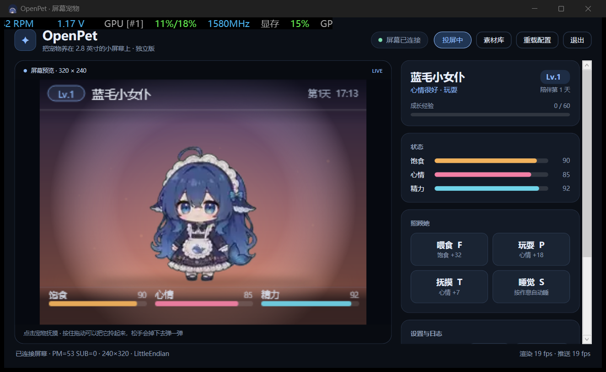
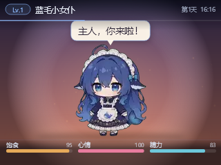
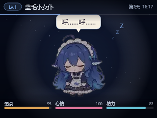
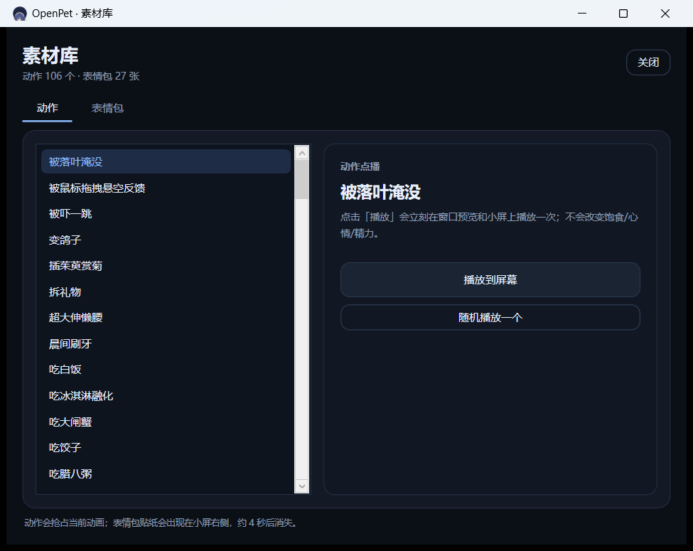
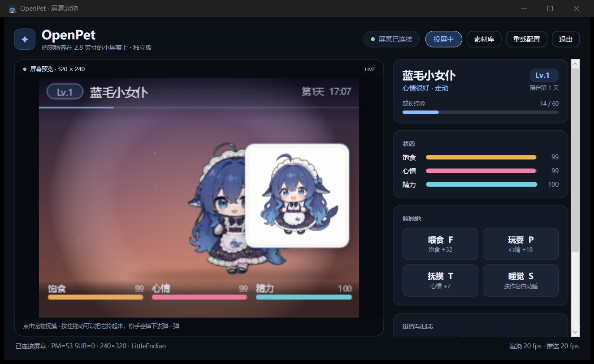

# OpenPet · 屏幕宠物

把 [dsh-pet](https://github.com/PC2005-cloud/dsh-pet) 的蓝毛小女仆，养在利民 2.8" / 320×240 USB 小屏上。
**独立应用**，不依赖 DSH、不连大模型；屏幕控制参考 [OpenTRCC](https://github.com/YannFang2002/openTRCC)。



| 白天（320×240 实际画面） | 夜晚睡觉 |
| --- | --- |
|  |  |

| 素材库（106 动作 / 27 表情） | 表情包贴纸投到屏幕 |
| --- | --- |
|  |  |

## 现在能做什么

- **屏幕直连**：HID `0416:5302`，513 字节报告、`DA DB DC DD` 握手、RGB565 全帧、512 字节分块推流；
  沿用 OpenTRCC 的握手/设备枚举/帧组装/旋转/字节序处理，实测 **PM=53 · 240×320 行序 · LittleEndian · rot90**。
- **真正「养」她**：饱食 / 心情 / 精力随时间衰减（关掉程序也继续算），按作息睡觉，喂食、玩耍、抚摸、点击回应、
  拖拽抛掷、经验升级、陪伴天数、冷却时间，状态落盘。
- **dsh-pet 同构配置**：`pets` / `animations` / `animationWeights` / `physics` / `eventsRefreshSec` / `font` / `memes`
  都能沿用 dsh-pet 的写法；额外增加 `needs` / `care` / `schedule` / `leveling` / `lines`。
- **全量素材**：dsh-pet 的 **106 个动作**全部接入，转成 320×180 / 12 fps 的 WebP 透明帧序列（约 73 MB）；
  另含 **27 张表情包贴纸**（约 4.5 MB）。待机、点击、拖拽、走动、吃饭、玩耍、睡觉、碎碎念、升级、余额、工作状态、文字梗都在。
- **素材库**：窗口里打开「素材库」（或按 `L`）可浏览 106 个动作并点播、预览 27 张表情包并「投到屏幕」；
  碎碎念也会按概率随机配一张贴纸。
- **窗口/托盘**：2 倍屏幕预览、状态条、经验条、日志、开机自启、关闭到托盘；屏幕不在时自动退化为纯预览并定期重连。
- **独立运行**：不调用任何模型，不依赖 DSH；所有台词与行为都在本地配置里。

## 快速开始

### 环境

- Windows 10/11 x64
- .NET 9 SDK（本工作区可直接用 `reference\OpenTRCC\.dotnet\dotnet.exe`）
- 利民 2.8" 320×240 USB 屏（`VID_0416&PID_5302`）；**先退出 TRCC / OpenTRCC**，它们会独占 HID

### 构建与运行

```powershell
# 在 coding\opentrcc-dsh-pet 下
.\scripts\build.ps1
.\scripts\run.ps1 -NoBuild
```

或者手动：

```powershell
dotnet build OpenPet.sln -c Release
.\src\OpenPet.App\bin\Release\net9.0-windows\OpenPet.exe
```

第一次启动会在窗口里显示预览；屏幕连接成功后，右下角状态变为「屏幕已连接」。
关闭窗口只会隐藏到托盘，宠物仍继续在屏幕上生活；托盘菜单「退出」才会结束进程。

### 第一次运行

- 默认读取包内 `assets/pet.jsonc`。
- 点「打开配置」会把配置复制到 `%LocalAppData%\OpenPet\pet.jsonc` 并用默认编辑器打开；
  之后启动优先读取用户配置。改完点「重载配置」即时生效。
- 状态保存在 `%LocalAppData%\OpenPet\pet-state.json`，日志在 `%LocalAppData%\OpenPet\app.log`。

## 操作

| 操作 | 方式 |
| --- | --- |
| 喂食 | 点「喂食」或按 `F`；饱食 +32、心情 +4、经验 +8，冷却 25 s |
| 玩耍 | 点「玩耍」或按 `P`；心情 +18、精力 −10、经验 +12，冷却 60 s |
| 抚摸 | 点「抚摸」或按 `T`；心情 +7、经验 +3，冷却 4 s |
| 睡觉/叫醒 | 点「睡觉」或按 `S`；夜里 23:00–07:30 也会自己睡 |
| 点击回应 | 在预览里点宠物；播放随机点击动画 |
| 拎起来 | 在预览里按住宠物拖动，松手会按重力/弹性掉落弹跳 |
| 动作/表情库 | 标题栏「素材库」或按 `L`；动作点播、表情包投屏 |
| 隐藏窗口 | `Esc` 或关闭按钮（托盘可找回） |
| 重载配置 | 标题栏「重载配置」或 `Ctrl+R` |

> 屏幕本身没有触摸，交互都在桌面窗口/托盘里完成，动作会实时同步到小屏。

## 配置

配置是 JSONC（允许 `//`、`/* */` 注释和尾随逗号）。完整默认值见 [assets/pet.jsonc](assets/pet.jsonc)。

### 顶层字段

| 字段 | 作用 |
| --- | --- |
| `activePetId` | 多只宠物时选哪一只（独立版一次只养一只） |
| `pets[]` | 与 dsh-pet 同构：`id` / `name` / `size` / `facing` / `fixedEnabled` / `whisperEnabled` / `display` / `position` |
| `display` | 屏幕外观：`theme`（auto/morning/day/dusk/night）、`hud`、`bubble`、`accent`、`bubbleColor`、`motionRangeX`、`floorY` |
| `font` | `family`（yahei=系统微软雅黑，默认且小屏更清晰 / candy=内置上首软糖体 / system）、`size`（气泡字号） |
| `needs` | 每小时衰减/回复：`hungerDecayPerHour`、`moodDecayPerHour`、`energyDecayPerHour`、`energyRegenPerHourSleeping`、阈值 |
| `care` | 三种互动的数值与冷却：`feed` / `play` / `pet` 的 `hunger`/`mood`/`energy`/`exp`/`cooldownSec` |
| `schedule` | `enabled`、`sleepStart`、`sleepEnd`、`autoSleepEnergy`、`wakeEnergy` |
| `leveling` | `baseExp`、`growth`、`maxLevel`；升级所需经验 = `baseExp × level^growth` |
| `physics` | 与 dsh-pet 同名：`gravity`、`restitution`、`groundFriction`、`ceilingBounce`、`throwPower`、`petCollision` |
| `animations` | 动画池：`idle`/`turn`/`drag`/`clicks`/`moves`/`categories`/`events` |
| `animationWeights` | `idle`/`turn`/`move` 的绝对百分比权重；剩余概率落到随机动作分类 |
| `eventsRefreshSec` | `whisper` = 本地碎碎念间隔（秒）；`balance` 仅为兼容 dsh-pet 保留 |
| `memes` | 表情包名称 → 描述；名称对应 `assets/memes/<名称>.png` |
| `display.memesEnabled` / `memeChance` / `memeDurationSec` / `memeSize` | 是否允许贴纸、碎碎念配图概率、停留秒数、屏幕边长 |
| `mouse` | `dragEnabled`、`clickReaction` |
| `lines` | 所有台词池：greeting/idle/feed/play/pet/sleep/wake/hungry/tired/lowMood/levelUp/tooFull/tooTired/cooldown/sleepingPet/offline |

### 动画池

- `animations.idle`：待机循环（必须至少一个可用动画）。
- `animations.turn`：播完翻转朝向。
- `animations.drag`：被拎起时的循环。
- `animations.clicks`：点击回应候选。
- `animations.moves.default` + `actions[]`：自主走动的距离/首尾停顿；距离按 `size / 462` 缩放。
- `animations.categories[]`：随机小动作分类，`weight` 只决定分类内分配；`noMirror: true` 的类在朝右时跳过。
- `animations.events`：显式事件池，键为 `feed` / `play` / `pet` / `sleep` / `wake` / `levelup` / `sad` / `whisper`。

动画名 = `assets/animations/<名字>/` 目录名。缺失的动画会写入日志并跳过；`idle` 全缺失会启动失败。

### 与 dsh-pet 配置的差异

- `pets` 只使用 `activePetId` 指定的那一只；`display` / `position` 仅做兼容解析。
- 不做 AI 碎碎念/对话、余额/工作状态与 DSH 的联动、系统通知、语音；余额/工作状态动作只作为普通随机动作播放。
- `animations.events` 是「每个事件一个数组」，不是 dsh-pet 的「档位可字符串/数组」两态；本独立版不需要档位轮换。
- `font.followPet` 暂未使用（气泡字号固定按 `font.size`）。
- `whisperEnabled` 对应本地碎碎念：不调用模型，只按 `eventsRefreshSec.whisper` 抽一句 `lines.idle` 并播 `events.whisper`。

### 动画素材

`assets/animations/` 已包含转换好的全部 106 个动作，`assets/memes/` 含 27 张表情包。重新生成（需要 Python 3.9+ 和 ffmpeg）：

```powershell
python tools\prepare_animations.py
# 或只转清单里的、强制重转
python tools\prepare_animations.py --force --workers 6
# 转源目录里的全部 webm
python tools\prepare_animations.py --all
```

> ffmpeg 必须用 `-c:v libvpx-vp9` 解码，否则 webm 的 alpha 会丢、背景变黑；
> 脚本已经处理。输出为 320×180 WebP 透明帧 + `meta.json`。

## 目录结构

```text
OpenPet.sln
src/
  OpenPet.Core/        RGB565、帧头/分块、BGRA、旋转、FramePump（改编自 OpenTRCC）
  OpenPet.Devices/     HID 传输、握手、设备枚举/profile、Thermalright Type-2（改编自 OpenTRCC）
  OpenPet.App/         WPF 窗口、宠物引擎、Skia 渲染、推流、托盘、存档
assets/
  pet.jsonc            默认配置
  animations/          106 个 WebP 帧序列（生成物）
  memes/               27 张表情包 PNG
  fonts/上首软糖体.ttf   dsh-pet 内置字体
  icon/app.ico         应用/托盘图标
docs/                  设计说明与截图
tools/                 动画转换脚本与清单
scripts/               构建/运行/发布脚本
```

## 屏幕协议与兼容性

- 设备：`USB\VID_0416&PID_5302`，`MI_00` 是 vendor HID（usage page `0xFF06`），每包 513 字节（1 字节 report id + 512 payload）。
- 握手：发 `DA DB DC DD ... 01` 的 512 字节请求，解析 `[5]=PM`、`[4]=SUB`、`[12]=0x01`；也支持 bcdDevice 4.07 的 3 秒后短回复路径。
- 帧：20 字节头（`DA DB DC DD | 02 00 | 01 00 | lineW lineH | 02 00 00 00 | len`）+ RGB565，按 512 字节分块写。
- 保活：面板约 2–3 秒没收到帧会回落开机 logo，`FramePump` 每 1.2 秒补发一次。
- `DeviceCatalog` 覆盖 OpenTRCC 已知的 320×240 面板（PM 49/50/51/52/53/58）；本机实测 PM=53。
- 只实现 RGB565；JPEG 面板（PM 54/114/128/192/224 等）会连接成功但显示「仅预览」。

## 诊断

```powershell
# 渲染一张 320×240 截图（不需要屏幕）
OpenPet.exe --snapshot out.png --at 4

# 夜间 + 睡觉状态
OpenPet.exe --snapshot night.png --at 2 --sleep --config my-night.jsonc

# 连屏幕推流 10 秒，结果写 %LocalAppData%\OpenPet\headless.log
OpenPet.exe --screen-test 10

# 48 小时加速模拟（作息/衰减/互动/升级）
OpenPet.exe --simulate 48
```

`--screen-test` 成功时会记录 `已连接屏幕 · PM=...`；失败会写 `屏幕被 TRCC 占用` 或 `未找到屏幕`。

## 已知限制

- 屏幕为 320×240、RGB565；其它分辨率/JPEG 面板未适配。
- 推流约 16–20 fps，动画素材 12 fps；静态待机也靠 1.2 s 保活。
- 不支持触摸；只能从桌面窗口/托盘操作。
- 多宠物配置只养 `activePetId` 一只。
- dsh-pet 的 AI 对话/语音/系统通知未移植（独立版故意不连 DSH）。
- TRCC / OpenTRCC 会独占设备，必须先退出；OpenTRCC 以管理员运行时，需要从它的托盘菜单退出。
- 自启写 `HKCU\...\Run`，路径指向当前 exe；移动目录后需重新勾选。

## 致谢与许可

- 屏幕控制、HID/协议、RGB565/旋转/帧组装：改编自 **OpenTRCC**（MIT，Copyright (c) 2026 OpenTRCC contributors）。
- 宠物动画、软糖体字体、配置结构：来自 **dsh-pet**（MIT，Copyright (c) 2026 PC2005-cloud）。
- SkiaSharp（MIT）用于渲染；PowerShell/Python 脚本仅用于素材转换。

第三方许可见 [LICENSES/](LICENSES/) 与 [THIRD-PARTY-NOTICES.md](THIRD-PARTY-NOTICES.md)。
