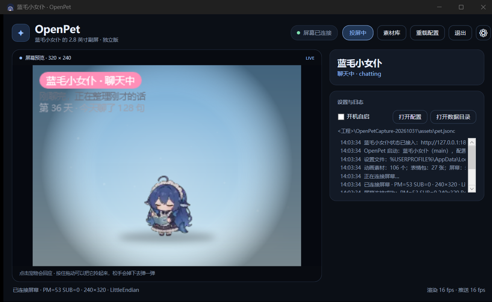
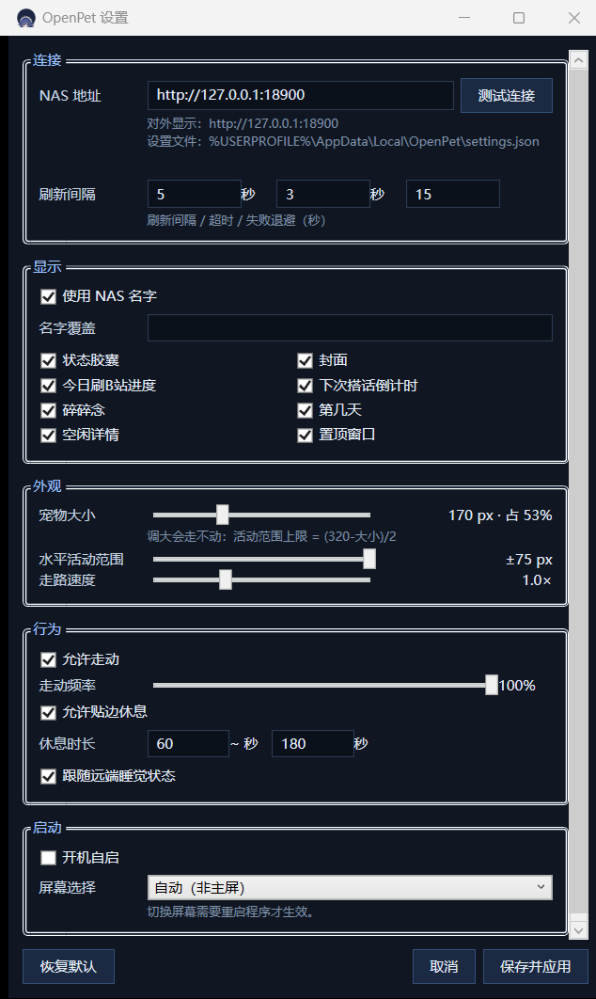

# OpenPet · 屏幕宠物

把 [dsh-pet](https://github.com/PC2005-cloud/dsh-pet) 的蓝毛小女仆放到利民 2.8" / 320×240 USB 小屏上。
**独立应用**，不依赖 DSH、不连大模型；屏幕控制参考 [OpenTRCC](https://github.com/YannFang2002/openTRCC)。
可选接入 NAS 侧的 AstrBot 插件，把「她现在在干什么」同步到小屏和桌面窗口。



| 设置窗口（连接 / 显示 / 外观 / 行为 / 启动） | 素材库（106 动作 / 27 表情） |
| --- | --- |
|  |  |

## 现在能做什么

- **屏幕直连**：HID `0416:5302`，513 字节报告、`DA DB DC DD` 握手、RGB565 全帧、512 字节分块推流；
  沿用 OpenTRCC 的握手/设备枚举/帧组装/旋转/字节序处理，实测 **PM=53 · 240×320 行序 · LittleEndian · rot90**。
- **远端状态**：定时读取 AstrBot 插件提供的只读状态，显示「聊天中 / 刷 B 站 / 空闲 / 睡觉」、状态详情、
  认识天数、今日消息数；刷 B 站时可显示封面、今日进度和下次倒计时。
- **碎碎念**：优先使用远端返回的最近原话，取不到时使用本地兜底台词；可按概率配一张表情包贴纸。
- **动作与互动**：106 个动作、27 张表情包；支持点击回应、拖拽抛掷、自主走动、贴边休息和跟随远端睡眠。
- **窗口/托盘**：320×240 实时预览、状态胶囊、连接状态、日志、开机自启、关闭到托盘；
  屏幕不在时自动退化为纯预览并定期重连。
- **设置窗口**：连接、显示、外观、行为、启动五组选项，保存后热应用。
- **素材库**：窗口里打开「素材库」（或按 `L`）可浏览 106 个动作并点播、预览 27 张表情包并「投到屏幕」。
- **独立运行**：不调用任何模型，不依赖 DSH；所有动画、台词与行为都在本地配置里。

## 配套服务端（可选）

小屏要显示「她现在在干什么」，需要 NAS 侧提供一个只读 HTTP 接口。`integrations/astrbot_plugin_screen_status/` 是 AstrBot 插件版，装到 AstrBot 的 `data/plugins/` 下即自动起服务（默认 18900），接口 `GET /api/state`。不用 AstrBot 也可以按 `integrations/` 里的 README 自己实现。

## 快速开始

### 环境

- Windows 10/11 x64
- .NET 9 SDK
- 利民 2.8" 320×240 USB 屏（`VID_0416&PID_5302`）；**先退出 TRCC / OpenTRCC**，它们会独占 HID

### 构建与运行

```powershell
.\scripts\build.ps1
.\scripts\run.ps1 -NoBuild
```

或者手动：

```powershell
dotnet build OpenPet.sln -c Release
.\src\OpenPet.App\bin\Release\net9.0-windows\OpenPet.exe
```

第一次启动会在窗口里显示预览；屏幕连接成功后，右上角状态变为「屏幕已连接」。
关闭窗口只会隐藏到托盘，宠物仍继续在屏幕上活动；托盘菜单「退出」才会结束进程。
没有连接屏幕时仍可预览和改设置，程序会定期重连。

### 第一次运行

- 默认读取包内 `assets/pet.jsonc`。
- 点「打开配置」会把配置复制到 `%LocalAppData%\OpenPet\pet.jsonc` 并用默认编辑器打开；
  之后启动优先读取用户配置。改完点「重载配置」即时生效。
- 设置窗口的选项保存在 `%LocalAppData%\OpenPet\settings.json`。
- 日志在 `%LocalAppData%\OpenPet\app.log`。

## 操作

| 操作 | 方式 |
| --- | --- |
| 打开设置 | 右上角齿轮，或按 `Ctrl+,` |
| 素材库 | 标题栏「素材库」，或按 `L` |
| 重载配置 | 标题栏「重载配置」，或按 `Ctrl+R` |
| 开/关投屏 | 标题栏「投屏中 / 投屏关」 |
| 点击回应 | 在预览里点宠物；播放随机点击动画 |
| 拎起来 | 在预览里按住宠物拖动，松手会按重力/弹性掉落弹跳 |
| 隐藏窗口 | `Esc` 或关闭按钮（托盘可找回） |
| 退出 | 托盘菜单「退出」 |

> 屏幕本身没有触摸，交互都在桌面窗口/托盘里完成，动作会实时同步到小屏。

## 配置

大多数日常选项都在设置窗口里改，保存在 `%LocalAppData%\OpenPet\settings.json`。
动画池、配色、物理等高级项仍在 JSONC 配置里；完整默认值见 [assets/pet.jsonc](assets/pet.jsonc)。

### 顶层字段

| 字段 | 作用 |
| --- | --- |
| `activePetId` | 多只宠物时选哪一只（独立版一次只显示一只） |
| `pets[]` | 与 dsh-pet 同构：`id` / `name` / `size` / `facing` / `fixedEnabled` / `position` |
| `display` | 屏幕外观：`theme`（auto/morning/day/dusk/night）、`hud`、`bubble`、`accent`、`bubbleColor`、`motionRangeX`、`floorY`、表情包相关开关 |
| `font` | `family`（yahei=系统微软雅黑，默认且小屏更清晰 / candy=内置上首软糖体 / system）、`size`（气泡字号） |
| `chatter` | 本地碎碎念：`enabled`、`minSec`、`maxSec`、`fallbackLines` |
| `physics` | 与 dsh-pet 同名：`gravity`、`restitution`、`groundFriction`、`ceilingBounce`、`throwPower`、`petCollision` |
| `animations` | 动画池：`idle`/`turn`/`drag`/`clicks`/`moves`/`categories`/`events` |
| `animationWeights` | `idle`/`turn`/`move` 的绝对百分比权重；剩余概率落到随机动作分类 |
| `mouse` | `dragEnabled`、`clickReaction` |

远端状态的地址、轮询间隔、超时、失败退避、封面开关和睡眠跟随都在设置窗口「连接 / 显示 / 行为」里调整，
保存后立即生效，不需要手改配置文件。

### 动画池

- `animations.idle`：待机循环（必须至少一个可用动画）。
- `animations.turn`：播完翻转朝向。
- `animations.drag`：被拎起时的循环。
- `animations.clicks`：点击回应候选。
- `animations.moves.default` + `actions[]`：自主走动的距离/首尾停顿；距离按 `size / 462` 缩放。
- `animations.categories[]`：随机小动作分类，`weight` 只决定分类内分配；`noMirror: true` 的类在朝右时跳过。
- `animations.events`：显式事件池，当前用于 `sleep` / `wake`。

动画名 = `assets/animations/<名字>/` 目录名。缺失的动画会写入日志并跳过；`idle` 全缺失会启动失败。

### 与 dsh-pet 配置的差异

- 独立版只显示 `activePetId` 指定的那一只；`display` / `position` 仅做兼容解析。
- 不移植 dsh-pet 的角色数值、AI 对话、语音和系统通知。
- 远端状态来自 AstrBot 的只读接口；没有服务端时仍可播放本地动画和碎碎念。
- `animations.events` 是「每个事件一个数组」，不是 dsh-pet 的「档位可字符串/数组」两态。
- `font.followPet` 暂未使用（气泡字号固定按 `font.size`）。

### 动画素材

`assets/animations/` 已包含转换好的全部 106 个动作，`assets/memes/` 含 27 张表情包。重新生成（需要 Python 3.9+ 和 ffmpeg）：

```powershell
python tools\prepare_animations.py
# 或只转清单里的、强制重转
python tools\prepare_animations.py --force --workers 6
# 转源目录里的全部 webm
python tools\prepare_animations.py --all
```

> ffmpeg 必须用 `-c:v libvpx-vp9` 解码，否则 webm 的 alpha 会丢、背景变黑；
> 脚本已经处理。输出为 320×180 WebP 透明帧 + `meta.json`。

## 目录结构

```text
OpenPet.sln
src/
  OpenPet.Core/        RGB565、帧头/分块、BGRA、旋转、FramePump（改编自 OpenTRCC）
  OpenPet.Devices/     HID 传输、握手、设备枚举/profile、Thermalright Type-2（改编自 OpenTRCC）
  OpenPet.App/         WPF 窗口、宠物引擎、Skia 渲染、推流、托盘、设置
integrations/
  astrbot_plugin_screen_status/  AstrBot 只读状态插件
assets/
  pet.jsonc            默认配置
  animations/          106 个 WebP 帧序列（生成物）
  memes/               27 张表情包 PNG
  fonts/上首软糖体.ttf   dsh-pet 内置字体
  icon/app.ico         应用/托盘图标
docs/                  设计说明与截图
tools/                 动画转换脚本与清单
scripts/               构建/运行/发布脚本
```

## 屏幕协议与兼容性

- 设备：`USB\VID_0416&PID_5302`，`MI_00` 是 vendor HID（usage page `0xFF06`），每包 513 字节（1 字节 report id + 512 payload）。
- 握手：发 `DA DB DC DD ... 01` 的 512 字节请求，解析 `[5]=PM`、`[4]=SUB`、`[12]=0x01`；也支持 bcdDevice 4.07 的 3 秒后短回复路径。
- 帧：20 字节头（`DA DB DC DD | 02 00 | 01 00 | lineW lineH | 02 00 00 00 | len`）+ RGB565，按 512 字节分块写。
- 保活：面板约 2–3 秒没收到帧会回落开机 logo，`FramePump` 每 1.2 秒补发一次。
- `DeviceCatalog` 覆盖 OpenTRCC 已知的 320×240 面板（PM 49/50/51/52/53/58）；本机实测 PM=53。
- 只实现 RGB565；JPEG 面板（PM 54/114/128/192/224 等）会连接成功但显示「仅预览」。

## 诊断

```powershell
# 渲染一张 320×240 截图（不需要屏幕）
OpenPet.exe --snapshot out.png --at 4

# 连屏幕推流 10 秒，结果写 %LocalAppData%\OpenPet\headless.log
OpenPet.exe --screen-test 10

# 直接打开设置窗口
OpenPet.exe --settings
```

`--snapshot` 会尽量沿用远端状态，这样名字和状态胶囊与真机一致；拉不到服务端时退回本地画面。
`--screen-test` 成功时会记录「已连接屏幕 · PM=...」；失败会写「屏幕被 TRCC 占用」或「未找到屏幕」。

## 已知限制

- 屏幕为 320×240、RGB565；其它分辨率/JPEG 面板未适配。
- 推流约 16–20 fps，动画素材 12 fps；静态待机也靠 1.2 s 保活。
- 不支持触摸；只能从桌面窗口/托盘操作。
- 多宠物配置只显示 `activePetId` 一只。
- 不包含 dsh-pet 的角色数值系统，也不移植 AI 对话、语音和系统通知。
- TRCC / OpenTRCC 会独占设备，必须先退出；OpenTRCC 以管理员运行时，需要从它的托盘菜单退出。
- 自启写 `HKCU\...\Run`，路径指向当前 exe；移动目录后需重新勾选。

## 致谢与许可

- 屏幕控制、HID/协议、RGB565/旋转/帧组装：改编自 **OpenTRCC**（MIT，Copyright (c) 2026 OpenTRCC contributors）。
- 宠物动画、软糖体字体、配置结构：来自 **dsh-pet**（MIT，Copyright (c) 2026 PC2005-cloud）。
- SkiaSharp（MIT）用于渲染；PowerShell/Python 脚本仅用于素材转换。

第三方许可见 [LICENSES/](LICENSES/) 与 [THIRD-PARTY-NOTICES.md](THIRD-PARTY-NOTICES.md)。
